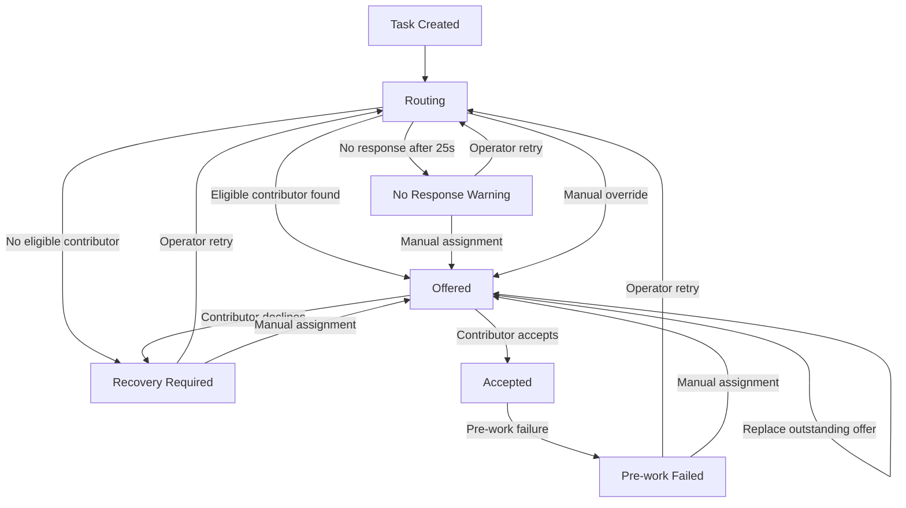

# TaskFlow — Backend

**Human-in-the-Loop Task Assignment System**

TaskFlow's backend implements persistent task routing, contributor assignment, human intervention, and recovery workflows.

The core engineering challenge is maintaining assignment consistency when automated routing responses are delayed, never arrive, or conflict with newer human decisions.

## Tech Stack

| Component | Technology |
|---|---|
| Runtime | Node.js |
| Language | TypeScript |
| API | Express |
| Database | SQLite (`sqlite3`) |
| Testing | Node.js `assert` with TypeScript test scripts |

**Verified runtimes:** Node.js 20.20.0 and 22.23.4.

The service uses a single Node.js process with a database-backed routing worker.

## Architecture

```text
        React Operator Dashboard
                 |
                 v
           Express REST API
                 |
    +-----+--------------------+
    |                          |
Task & Assignment       Routing Worker
State Transitions       Startup + Periodic Sweep
    |                          |
    +-------------+------------+
                  |
                  v
           SQLite Database
          (WAL + Transactions)
                  |
        Tasks / Contributors
        Assignments / Attempts
             Audit Events
```

The backend is the authoritative source of task and assignment state.

Routing outcomes and timestamps are persisted before processing so that restarts do not regenerate results or lose outstanding attempts.

## Project Structure

The backend follows a lightweight, modular structure. HTTP endpoints, database operations, routing execution, and assignment transitions are separated by responsibility without introducing unnecessary framework layers.

```text
server/
├── src/
│   ├── app.ts              # Express app, API routes, validation,
│   │                       # and HTTP error handling
│   ├── server.ts           # Server startup and routing worker lifecycle
│   ├── database.ts         # SQLite connection, schema initialization,
│   │                       # persistence, and database configuration
│   ├── routing-worker.ts   # Persisted routing attempt processing,
│   │                       # recovery sweeps, and stale-result protection
│   └── transitions.ts      # Transactional assignment state changes,
│                           # manual overrides, acceptance, decline,
│                           # failure, and explicit retry
│
├── tests/
│   ├── api.test.ts          # API, routing, persistence,
│   │                        # and restart behavior tests
│   └── intervention.test.ts # Human intervention, state transitions,
│                            # concurrency, and recovery tests
│
├── .env.example             # Example environment configuration
├── .gitignore               # Excludes local and generated files
├── package.json             # Dependencies and development scripts
├── package-lock.json        # Locked dependency versions
├── tsconfig.json            # TypeScript compiler configuration
└── README.md                # Backend architecture and API documentation
```

### Separation of Responsibilities

| Module | Responsibility |
|---|---|
| `app.ts` | HTTP request handling, input validation, response formatting, and API routing |
| `database.ts` | Database initialization, persistence, and transaction infrastructure |
| `routing-worker.ts` | Processing persisted routing attempts and reconciling work after restarts |
| `transitions.ts` | Enforcing assignment lifecycle rules and atomic human interventions |
| `server.ts` | Starting the API server and routing worker |
| `api.test.ts` | Verifying API behavior and automatic routing |
| `intervention.test.ts` | Verifying manual overrides, concurrency protection, and recovery |

### Design Rationale

The architecture separates HTTP transport from assignment state management and background routing.

This keeps the most important business rules independently inspectable and testable.

The application intentionally avoids additional service abstractions, dependency injection frameworks, and distributed infrastructure because they would increase complexity without improving the core assessment requirements.

The codebase is organized around clear responsibilities rather than a large number of folders.

## API Reference

### Task Management

| Method | Endpoint | Description |
|---|---|---|
| GET | `/api/health` | Check API availability |
| POST | `/api/tasks` | Create a task and initial routing attempt |
| GET | `/api/tasks` | List tasks and current states |
| GET | `/api/tasks/:taskId` | Retrieve task details, routing attempts, assignments, audit history, and eligible contributors |

### Human Intervention & Recovery

| Method | Endpoint | Transition |
|---|---|---|
| POST | `/api/tasks/:taskId/assignments` | Create a manual assignment offer or replace an outstanding offer |
| POST | `/api/tasks/:taskId/assignments/:assignmentId/accept` | `offered` → `accepted` |
| POST | `/api/tasks/:taskId/assignments/:assignmentId/decline` | `offered` → `recovery_required` |
| POST | `/api/tasks/:taskId/assignments/:assignmentId/fail` | `accepted` → `pre_work_failed` |
| POST | `/api/tasks/:taskId/routing` | Explicitly start a new routing attempt from an eligible recovery state |

Task-detail responses include routing attempts, assignments, eligible contributors, and audit events.

`POST /api/tasks`, `POST /api/tasks/:taskId/assignments`, and `POST /api/tasks/:taskId/routing` return HTTP 201. Accept, decline, and fail return HTTP 200. A missing task or unknown route returns HTTP 404 `not_found`.

Mutation requests require the task `version` last read by the caller. Creating a task does not. Task bodies use `requiredExpertise`. Assignment and response bodies use `contributorId`, `version`, and an optional `responseNote`.

### JSON names

Tasks and assignments use camelCase (`requiredExpertise`, `activeAssignmentId`, `offeredAt`, `responseNote`).

Routing attempts on `GET /api/tasks/:taskId`, and the `routingAttempt` object on a successful retry, use snake_case: `due_at`, `warning_at`, `selected_contributor_id`, `task_version_at_creation`, `created_at`, and `completed_at`. The dashboard accepts either spelling when it reads a task detail. It renders the detail payload, not the `routingAttempt` field on the retry response.

### Request errors

A body that is not valid JSON (`entity.parse.failed`) returns:

- HTTP 400
- code `validation_error`
- message `Request body must be valid JSON.`

The parser text and the raw body are not included.

A validation failure on a parsed body also uses HTTP 400 `validation_error`, with `Request validation failed.` and a `details` object.

Any other error uses its status, or HTTP 500 when it has none. A status of 500 or higher is logged on the server. The response message is `An unexpected error occurred.` The code is the error’s code, or `internal_error` when it has none. The exception text is not sent to the client. A status below 500 keeps the error message and, when present, `details`.

## Routing Simulation

The worker simulates an asynchronous assignment service. On startup, and then every second, it sweeps pending attempts.

Initialization inserts four contributors if they are absent: Ada Lovelace (`frontend`), Grace Hopper (`backend`), Margaret Hamilton (`qa`), and Don Norman (`design`).

- A successful match is due after 5–20 seconds (`5 + floor(random * 16)`). That due time is stored when the attempt is created.
- When a contributor is selected, about 20% of attempts are stored as `no_response` and never return.
- A no-response attempt sets `warning_at` to 25 seconds after creation. At that time the task becomes `no_response_warning`. The attempt stays unresolved, and `completed_at` stays null.
- Contributors are matched by normalized expertise tags. One matching active contributor is chosen at random. Declined and pre-work-failed contributors are excluded from the next automatic attempt for that task.
- No matching contributor is stored as `outcome = success` with `selected_contributor_id = null`. When due, the task becomes `recovery_required` and no assignment is created.
- An unresolved request is not classified as a confirmed failure.
- Automatic retries are not triggered by no-response warnings.
- Retry is allowed from `routing` only when no attempt is still pending, and from `no_response_warning`, `pre_work_failed`, and `recovery_required`. A pending retry returns HTTP 409 `conflict`. Replacing an offer stays `offered`; it does not return the task to `routing`.

### Routing Outcomes

| Outcome | Result |
|---|---|
| Successful match | Creates an assignment offer |
| No eligible contributor | Transitions to `recovery_required` |
| No response | Remains unresolved with `no_response_warning` |
| Superseded result | Ignored without changing the newer task decision |

Each attempt stores its outcome, due time, warning time, selected contributor, and task version.

A startup sweep and periodic worker processing reconcile persisted attempts. Repeated sweeps must not create duplicate assignments.

## Assignment Lifecycle

The assignment workflow distinguishes between an offer, acceptance, decline, and failure before work begins.

- **Offered:** A contributor has been selected but has not accepted.
- **Accepted:** The contributor accepts; normal routing and manual replacement are blocked.
- **Declined:** The task requires recovery; no automatic retry is started.
- **Pre-work failed:** An accepted assignment failed before work began, allowing explicit recovery.

Operators can manually assign eligible contributors while routing is pending, delayed, or awaiting recovery.

A manual assignment can replace an outstanding offer but cannot replace an accepted assignment through the normal workflow.

Contributors who previously declined or failed are excluded from subsequent automatic matching for the same task. An operator can still select them explicitly.

### Task State Transitions

The task lifecycle supports automatic assignment, contributor responses, and explicit operator recovery.



**Key rules:**

- An accepted assignment cannot be replaced by normal routing.
- Manual intervention supersedes outstanding routing attempts.
- No-response warnings remain unresolved until an operator intervenes.
- Decline and pre-work failure require explicit recovery.
- State changes are validated transactionally against the latest task version.

The diagram represents task-level state transitions; routing attempts and individual assignments maintain their own lifecycle records.

## Consistency and Concurrency

### Assignment Integrity

**Invariant: Each task has at most one active assignment.**

An active assignment is a row whose status is `offered` or `accepted`. The partial unique index `assignments_one_active_idx` is `ON assignments(task_id) WHERE status IN ('offered', 'accepted')`.

Writes that must stay together use `BEGIN IMMEDIATE` on one connection, queued so those writers do not overlap. `PRAGMA foreign_keys = ON`, `journal_mode = WAL`, and `busy_timeout = 5000` are set when the database opens. `active_assignment_id` is not a foreign key. It is set in the same transaction as the assignment row. GET handlers use that connection outside the writer queue. A dirty read during an open transaction was not reproduced.

### Optimistic Concurrency

Every mutation requires the latest task `version`.

Updates validate the expected version and allowed state inside a transaction.

When the supplied version is stale, the API returns:

`HTTP 409 Conflict`

The caller must refresh task details before attempting another mutation.

### Stale-Response Protection

A routing result is applied only if the task remains in the expected state and its version is still current.

Manual intervention supersedes pending attempts atomically.

Late automated responses cannot overwrite newer operator decisions.

### Idempotent Routing

Repeated worker sweeps, including processing after restart, must not create duplicate offers or duplicate routing-completion events.

## Persistence and Audit History

The default database path is `../data/taskflow.sqlite`, resolved from the server directory. That is `data/taskflow.sqlite` at the repository root. Set `DATABASE_PATH` to override it. `PORT` defaults to `3001`. Both names are in `.env.example`. The process does not load a `.env` file by itself.

Root `.gitignore` ignores `data/*.sqlite`, `data/*.sqlite-wal`, and `data/*.sqlite-shm`. `server/.gitignore` uses the same three patterns under `server/data/`. A rollback journal name is not covered by a separate ignore rule. WAL mode makes that file unlikely.

SQLite configuration includes:

- Foreign key enforcement
- Write-Ahead Logging (WAL)
- Busy timeout for concurrent writers
- Transactional state updates

The three ignore patterns above are what keep the local database out of Git.

Meaningful actions are recorded through append-only audit events.

Events include:

- `task_created`
- `routing_offer_created`
- `routing_no_eligible_contributor`
- `routing_no_response_warning`
- `routing_result_ignored`
- `manual_assignment_created`
- `assignment_superseded`
- `routing_attempts_superseded`
- `assignment_accepted`
- `assignment_declined`
- `assignment_pre_work_failed`
- `routing_retried`

This provides a traceable history of automation decisions, human overrides, and recovery actions.

## Running Locally

From the `server` directory:

```bash
npm install
npm run dev
```

Check API availability:

```bash
curl http://localhost:3001/api/health
```

`src/server.ts` reads `PORT` and calls `app.listen(port)` without a host, so the process accepts connections on the unspecified address. CORS is open. There is no authentication.

### Verification

Run TypeScript checks:

```bash
npm run typecheck
```

Run backend tests:

```bash
npm test
```

The current test command executes:

```text
tests/api.test.ts
tests/intervention.test.ts
```

On November 7, 2026, `npm run typecheck` and `npm test` exited 0 on Node.js 20.20.0 and 22.23.4. `package.json` sets `"node": ">=20"`. The test command prints `API and routing tests passed.` and then `Intervention tests passed.` It does not print a numeric count.

Core test coverage includes routing outcomes, restart recovery, repeated worker sweeps, stale task versions, manual overrides, contributor responses, and explicit recovery.

These automated results do not replace manual end-to-end UI verification.

## Implementation Status

| Component | Status |
|---|---|
| Express API and task management | Implemented |
| SQLite persistence | Implemented |
| Contributor matching | Implemented |
| Persisted routing worker | Implemented |
| Delayed/no-response handling | Implemented |
| Restart recovery | Implemented |
| Manual assignment and override | Implemented |
| Contributor accept / decline / fail | Implemented |
| Explicit recovery and retry | Implemented |
| Version-based concurrency protection | Implemented |
| Append-only audit history | Implemented |
| Backend integration tests | Passed in reported runs |
| React operator dashboard | Implemented |
| Final manual end-to-end verification | Recorded in `docs/QA_CHECKLIST.md` |

## Engineering Tradeoffs

**Single-process architecture:** Keeps the assessment focused on correctness without introducing distributed infrastructure.

**SQLite rather than an external database:** Provides local durability and transactional consistency with minimal setup.

**Persisted routing attempts:** Preserve simulated outcomes across restarts and avoid reliance on in-memory timers alone.

**Optimistic concurrency:** Rejects stale actions rather than silently replacing newer task decisions.

**Exact expertise matching:** Keeps contributor selection transparent and predictable.

**Polling instead of WebSockets:** Simplifies frontend integration for a small operator dashboard.

## Known Limitations

- No authentication or authorization. CORS is open, and the server is not bound to localhost.
- Contributor responses are simulated through API actions.
- Repeated mutations using an outdated task version return HTTP 409 `conflict`, rather than replaying the original successful response. `invalid_assignment` and `invalid_transition` also use HTTP 409. The dashboard shows one conflict sentence for all of them.
- Malformed JSON is HTTP 400 `validation_error`. Unexpected failures stay HTTP 500 with `An unexpected error occurred.` The client still presents HTTP 500 as a connection failure.
- The application is designed for a single backend process, not a distributed worker deployment. Two processes can write one file; `BEGIN IMMEDIATE`, `busy_timeout`, and the unique index are the cross-process controls.
- Routing attempt JSON is snake_case. Tasks and assignments are camelCase.
- The dashboard history does not render the acceptance note stored on `assignment_accepted` after a later response overwrites `assignments.response_note`.
- A task with no remaining eligible contributors requires operator intervention.

These limitations are documented rather than hidden.

## Scope

The assessment intentionally excludes external AI services, complex recommendation models, production queues, multi-tenant infrastructure, and deployment requirements.

The implementation prioritizes correctness, recovery, human oversight, and maintainability.

For the complete application overview, see the [main README](../README.md).

For the manual test plan, see [Manual QA Checklist](../docs/QA_CHECKLIST.md).
